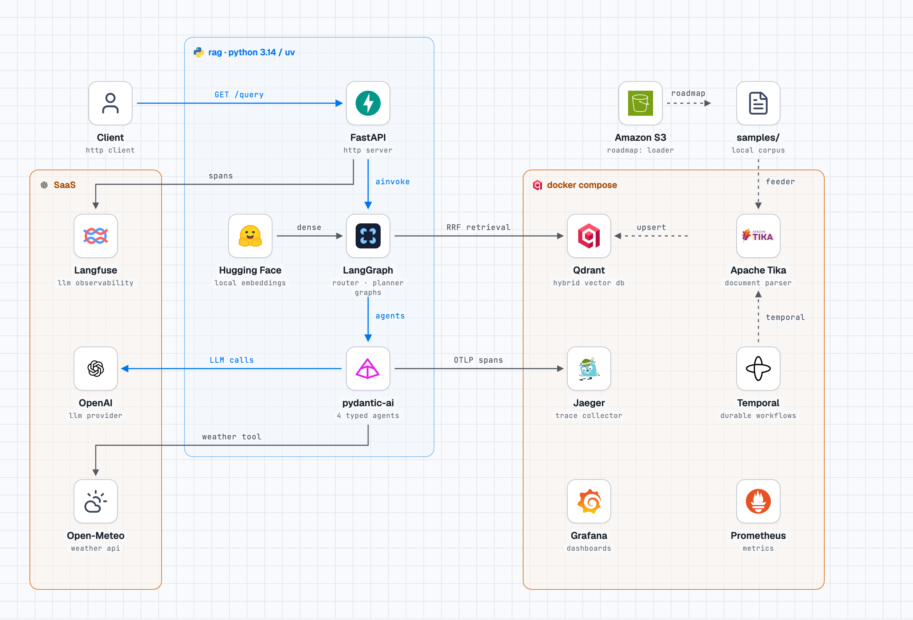
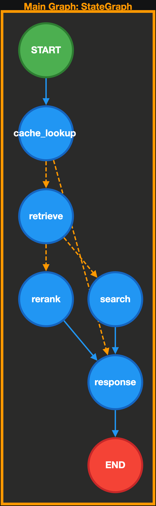
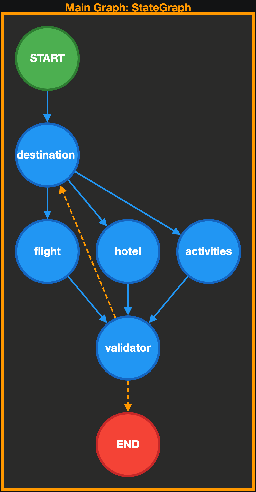

# RAG × Agentic Travel Planner

A portfolio project designed to demonstrate two disciplines end to end:

1. **RAG (Retrieval-Augmented Generation)** — a document ingestion pipeline with hybrid (dense + BM25) retrieval into Qdrant.
2. **Agentic programming** — a multi-agent travel-planning workflow built with pydantic-ai and LangGraph, with validation/retry loops, model mocking, and full OpenTelemetry tracing.

It is meant to be read alongside the code: every subsystem below maps 1:1 to a file in `src/`.

## Architecture



### Graphs
<table  align="center">
  <tr>
    <td></td>
    <td></td>
  </tr>
</table>

## The RAG pipeline, step by step

**1. Load** (`feed/loader.py`) — a local file walker that yields every file in a directory. Deliberately boring: format detection is delegated to Tika, so the loader never dispatches on extension.

**2. Parse** (`feed/parsers.py`) — Apache Tika (as a sidecar container) extracts text and standardized metadata (Dublin Core keys like `dc:title`, `dcterms:created`) from any file type. Decision: parsing is a lossy, messy problem with a solved industry answer — running Tika instead of hand-rolling PDF/Office parsing keeps this step a thin adapter.

**3. Split** (`feed/splitter.py`) — strategy pattern keyed on content type:
- Markdown → `MarkdownHeaderTextSplitter` (preserves heading structure as chunk metadata)
- Go source → `RecursiveCharacterTextSplitter.from_language` (syntax-aware)
- Everything else → generic recursive splitter (500 chars / 50 overlap)

**4. Index** (`database.py`) — documents are embedded with `sentence-transformers/all-MiniLM-L6-v2` (384 dims) and upserted **with two vector representations**:
- a named dense vector for semantic similarity,
- a sparse `bm25` vector computed **server-side by Qdrant** (`PointStruct(vector={"bm25": models.Document(text=..., model="Qdrant/bm25")})`).

  Decision: server-side BM25 means the client never runs its own sparse model — Qdrant tokenizes and builds the sparse vector at write time, and the payload carries the embedding model name for traceability/zero-downtime reindexing.

  Chunk/document IDs are deterministic (`uuid5` of source path + chunk index, `feed/chunks.py`): re-running the feeder updates in place instead of duplicating the corpus.

Source files are mocked-free here — the whole pipeline runs over real `samples/` content.

## Agentic patterns

The travel planner is built from three canonical agentic control patterns, each mapped to real graph edges rather than prose:

**Router** (`dag/workflows/router.py`) — an entry graph that inspects the request against the knowledge base and routes it to the right path (retrieval-grounded answer vs. full agentic planning). Routing is an explicit LangGraph conditional edge, not a hidden `if`, so the decision point is traceable and testable in isolation.

**Parallelism** (`dag/workflows/travel_planner.py`) — after the destination is chosen, three independent agents (flight, hotel, activities) run **fan-out**, joined by a synchronization point: the validator only fires once all three have returned. Decision: independent subtasks execute concurrently per graph structure, so latency scales with the slowest agent, not their sum.

**Reflection** — the planner does not trust its agents' first attempt. A **validator** node scores the assembled state (all four outputs present?) and routes on failure back through the whole loop, bounded by `TravelDeps.retries`. Decision: reflection via a deterministic checker node instead of agent self-critique — for typed, structural outputs (`DestinationOutput`, `FlightOutput`, ...) a validation check is cheaper, more reliable, and statically inspectable; an LLM judge can sit on top later.

## The retrieval/query path, step by step

Each `/query` request flows through a **two-level LangGraph**:

**Router graph** (`dag/workflows/router.py`) — decides how to answer:
1. **router** — searches Qdrant (hybrid query below) to gauge KB coverage.
2. **search** — invokes the full travel-planner graph when we need a composed answer.
3. **respond** — maps the result to the final `{query, response}` contract.

Retrieval is **hybrid fusion**: two `Prefetch` legs (dense embedding of the query; sparse BM25 via the server-side document model), fused with **Reciprocal Rank Fusion** (`FusionQuery(Fusion.RRF)`). Decision: RRF over score interpolation — it needs no score calibration between two objectively incomparable scales (cosine vs TF-IDF), works well as a default, and is one Qdrant call instead of client-side merging.

```python
results = self.client.query_points(
    collection_name=self.collection_name,
    prefetch=[
        models.Prefetch(query=dense_vector, using="dense", limit=50),
        models.Prefetch(query=models.Document(text=query, model="Qdrant/bm25"), using="bm25", limit=50),
    ],
    query=models.FusionQuery(fusion=models.Fusion.RRF),
    limit=limit,
    with_payload=True,
)
```

**Travel-planner graph** (`dag/workflows/travel_planner.py`) — the agentic part:
1. **destination** agent (with a `get_weather` tool) chooses a destination
2. **flight / hotel / activities** agents fan out **in parallel** from the destination node
3. **validator** checks that all four outputs landed; routing after validation either finishes, or **retries the whole loop** (bounded by `TravelDeps.retries`)

Each agent node is wrapped by `traced_node` (`src/tracing.py`) so LangGraph node spans exist separately from the pydantic-ai model-call spans.

## Technologies and the decisions behind them

| Choice | Why |
|---|---|
| **pydantic-ai** | Typed agent outputs (`schemas.py`): LangGraph state keys are statically checked against the agents' schemas (the `*Update` TypedDicts), so a schema drift is a type error, not a runtime surprise. Agents are configured from YAML (`dag/config/*.yaml`) — model, fallbacks, temperature, capabilities — kept out of code so switching providers is a config edit. |
| **pydantic-ai `Hooks`** | `dag/agents/hooks.py` registers `before_run` cross-cutting behavior on every agent run without polluting node code. (Roadmap: full-permission ACL per principal, see `dag/security/permissions.py`.) |
| **LangGraph** | The workflow is genuinely graph-shaped: parallel fan-out + a retry loop + conditional routes. This is exactly what Mermaid-style graphs misrepresent; LangGraph executes DAGs and conditional edges natively. |
| **Qdrant** | One engine for both halves of hybrid retrieval, including server-side BM25. |
| **FastAPI** | Thin HTTP boundary + `Depends`-based graph injection, contextvars for `request_id`/`user_id` propagation into spans. |
| **OpenTelemetry + Langfuse** | One global `TracerProvider` in `tracing.py` carries two exporters: the LLM/agent telemetry goes to **Langfuse** (spans, generations, token usage), while the same spans also stream to a **self-hosted Jaeger** collector. Decision: LLM observability and infrastructure tracing come from one span tree rather than two parallel logging schemes. |
| **Prometheus/Grafana** (compose file) | Metrics sidecar of the same monitoring stack. |
| **tenacity + pybreaker** | `APIClient` retries transient HTTP failures with exponential backoff and retryable-status classification; the weather **tool** is wrapped in a circuit breaker so a failing external API degrades the agent gracefully instead of hanging the graph. |
| **uv, Python 3.14** | Fast resolution and reproducible lockfile; modern typing used throughout (protocols, generics, StrEnum). |

## Patterns worth noticing

- **ABCs replaced by `Protocol`s** (`feed/pipeline.py`): the pipeline components are duck-typed, so concrete implementations (`LoaderLocal`, `ParserTika`, `QdrantDatabase`) need no inheritance to satisfy the pipeline's contracts.
- **Composition root** (`src/main.py`): every dependency — API client, database, mock-vs-real agents — is assembled in one place. Agents are injected as model overrides via `build_agent_*(file_path, mock_model=...)`; `FunctionModel` (`dag/agents/mocks.py`) returns schema-typed canned responses, so the whole graph runs offline/without API keys. Decision: mocking is centralized at the wiring layer instead of sprinkled through agent code, and it doubles as the seam for future real-model `FallbackModel` chains (the commented blocks in `agents.py`).
- **Ports and adapters**: `API`/`DatabaseRetrieve` `Protocol`s in `travel_planner.py`/`router.py` define what the graphs need; `httpx`-backed `APIClient` and `QdrantDatabase merely satisfy them.
- **Decorator-based tracing**: one `@traced_node` decorator covers both sync and async LangGraph nodes, keeping observability orthogonal to workflow logic.
- **Policy as data**: roles/permissions (`dag/security/permissions.py`) are frozen sets of enums, ready to be enforced through agent hooks.

## Running it

```bash
docker compose up -d             # Qdrant, Tika, Jaeger, Temporal + app (:8010, live reload)
docker compose run --rm app sh -c "PYTHONPATH=/app:/app/src uv run python src/feeder.py"  # ingest samples/

curl "http://127.0.0.1:8010/query?query=where%20should%20I%20go%20next%20weekend"
```

The `app` service mounts the repo into the container and runs uvicorn with `--reload` — edits to `src/` restart the worker automatically. Its env vars point the telemetry and data stores at the compose services (Jaeger, Qdrant, Tika). Without Compose, run the app directly: `uv run python src/main.py`.

For LLM tracing, set `LANGFUSE_PUBLIC_KEY` / `LANGFUSE_SECRET_KEY` / `LANGFUSE_BASE_URL` in `.env`; without them tracing silently degrades to the local Jaeger collector. `MOCK`-behaviour is wired in `main.py`; agents currently ship mocked by default so the stack runs with zero external model accounts.

## Roadmap

- **Guardrails** — the validator loop is the kernel; extend with input/output policies and domain-specific checks.
- **Grounded answers with citations** — a respond path that answers strictly from retrieved chunks and returns a contract like:

  ```json
  { "status": "answered", "answer": "The approved carry-forward limit is ten days.",
    "citations": ["HR-POLICY-2026-SECTION-8"], "confidence": 0.91 }
  ```

  ...and **abstains** instead of hallucinating when retrieval can't support the claim:

  ```json
  { "status": "abstained", "reason": "The available documents do not establish the requested fact.", "citations": [] }
  ```

- Router short-circuit: serve a cached response on a high-confidence KB hit instead of always invoking the planner (the hook is marked `# TODO` in `router.py`).
- **Temporal** — the docker compose already ships a Temporal server; move the ingestion pipeline onto a durable `LoaderLocal → ParserTika → Splitter → Qdrant` workflow so re-indexes survive crashes, retry per-file with visibility, and can be scheduled (incremental re-feed) instead of run as a one-shot script.
- **S3 ingestion** — a `LoaderS3` (listing + fetching documents from a bucket) as a drop-in for `LoaderLocal`; both satisfy the same `Loader` protocol, so the pipeline composes over remote corpora unchanged. Natural follow-up to the Temporal step: long object downloads belong in durable, resumable workflows.
- **Retrieval evals** — a test harness for RAG retrieval quality: a labeled set of queries over `samples/` (question → expected chunk/document), and metrics on the hybrid retriever (recall@k, MRR) run in CI so changes to `Chunk` sizes, splitters, or fusion settings are regression-tested, not eyeballed.
- Real-model wiring: enable the commented `FallbackModel` chains in `agents.py`.
- Full ACL enforcement inside agent hooks via `Principal.can_use_agent`.
